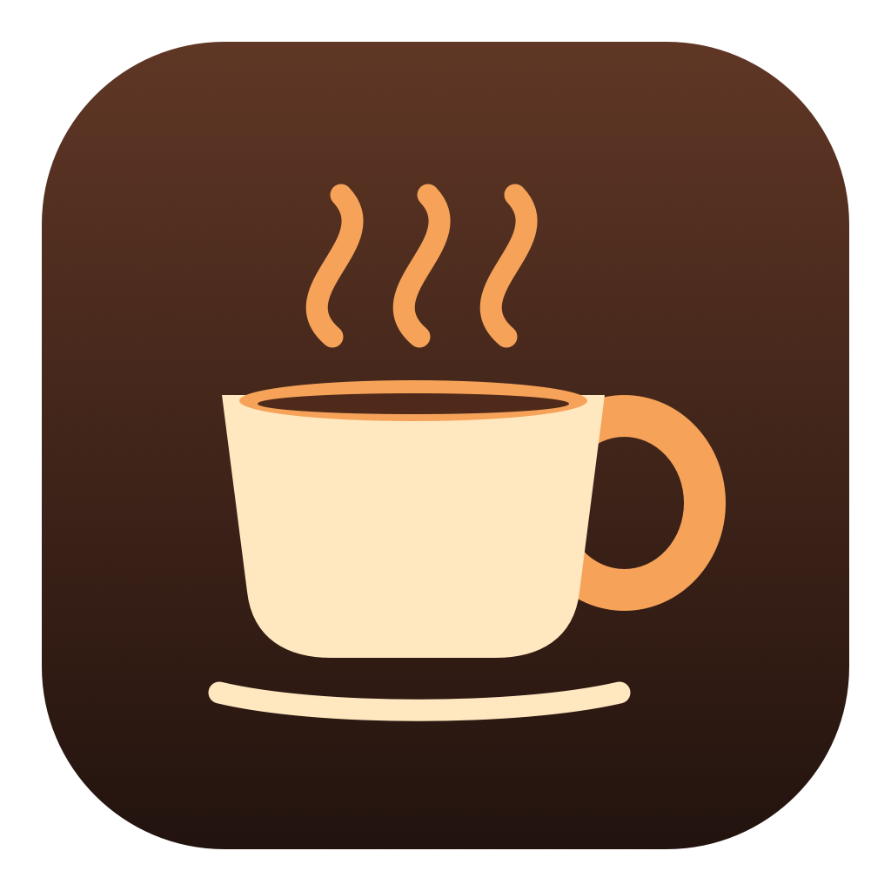

# Caffeinate Bar



A tiny macOS menu bar app with three choices:

- **caffeinate -d** — keep the display awake.
- **caffeinate -i** — prevent idle system sleep, while allowing the display to sleep.
- **Disable** — stop caffeinating.

The cup fills when active. No Dock icon, settings window, or extra menus.

## Install

Requires **macOS 13 or newer**, Xcode Command Line Tools (including Swift and Python 3), and Git. Works on Apple silicon and Intel; the build targets your Mac.

If you don't have the command line tools, run `xcode-select --install` and finish the installer first.

Then run:

```sh
git clone https://github.com/QuirkyTurtle94/caffeinate-bar.git
cd caffeinate-bar
./build.sh
mkdir -p "$HOME/Applications"
ditto CaffeinateBar.app "$HOME/Applications/CaffeinateBar.app"
open "$HOME/Applications/CaffeinateBar.app"
```

Click the coffee cup in your menu bar and choose a mode. The app is built and signed locally; no downloaded app binary is required.

## Start at login

The app automatically registers to launch at login the first time you open it. If macOS asks, allow it in **System Settings → General → Login Items**. It starts with caffeinate **disabled** each time.

Keep the installed app in the same location. To turn off automatic startup, disable CaffeinateBar in Login Items.

## Quit or uninstall

Choose **Disable**, then quit CaffeinateBar using Activity Monitor. To uninstall, also remove its Login Items entry and move the app to Trash.

## Notes

- Only one mode runs at a time. Other caffeinate processes are left alone.
- Closing your laptop lid is not overridden.
- The source is in `Sources/main.swift`. Run `./build.sh` to rebuild; quit the app before replacing an installed copy.
- The custom icon and its drawing script are in `Resources/`.
